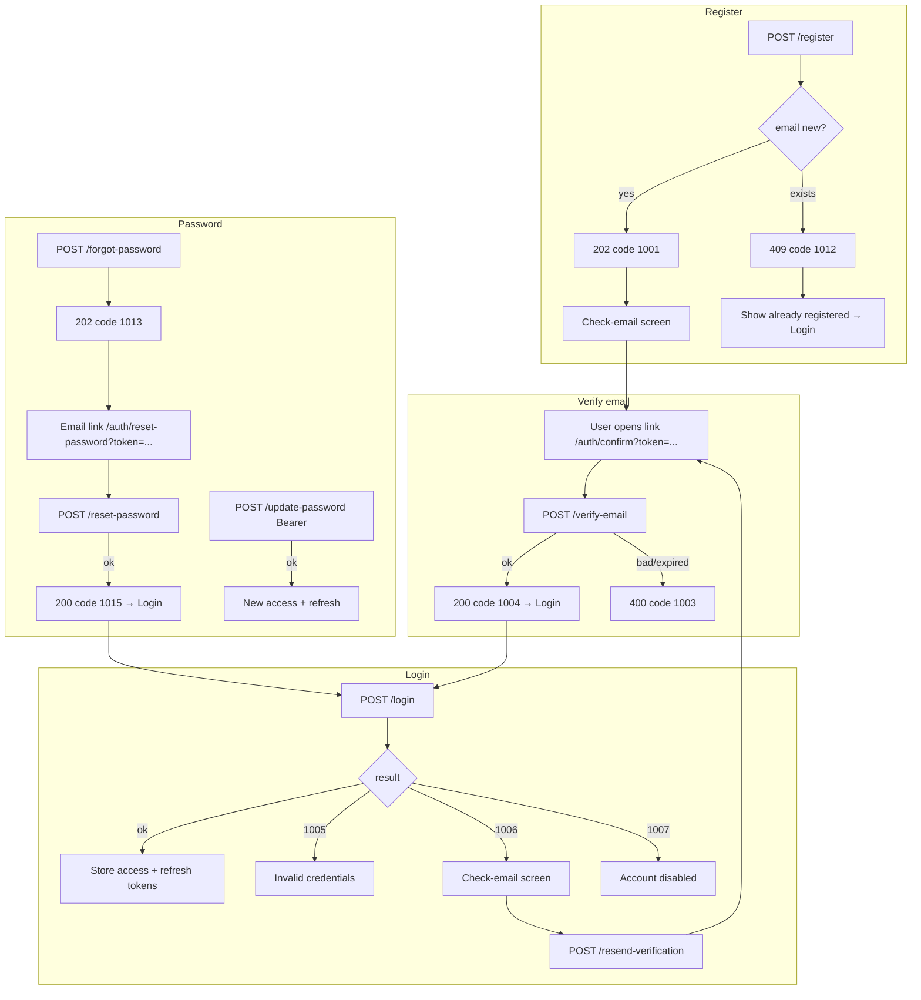
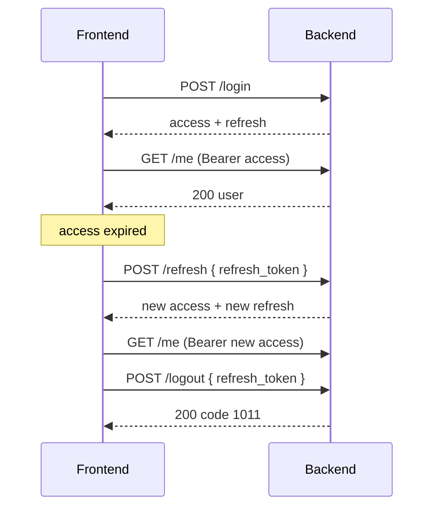
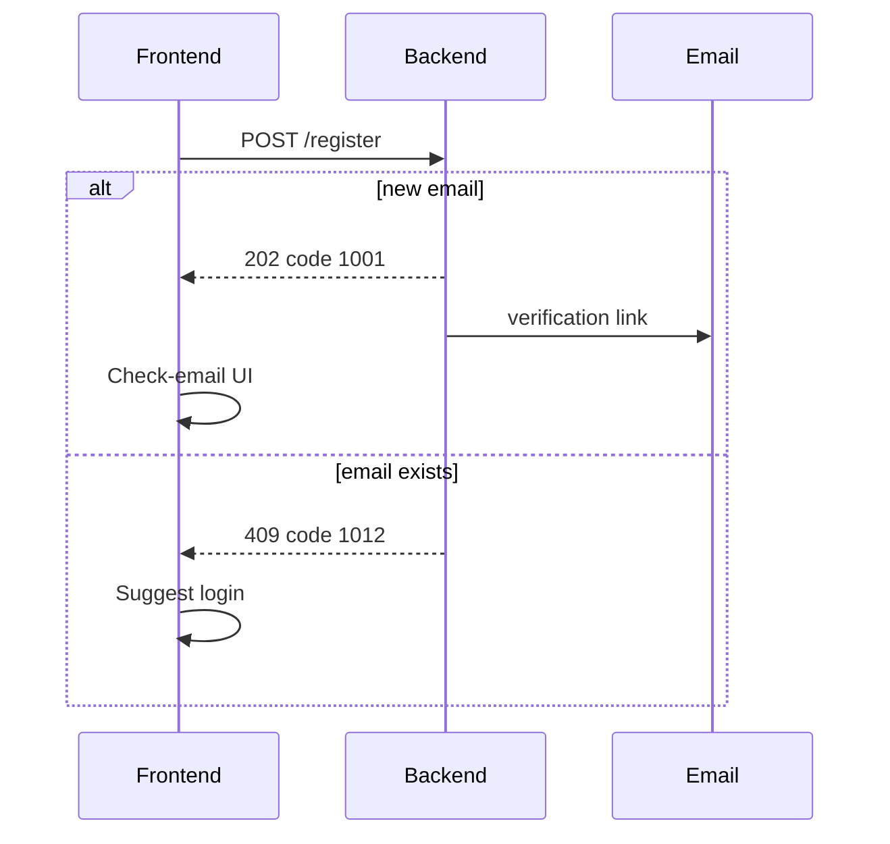
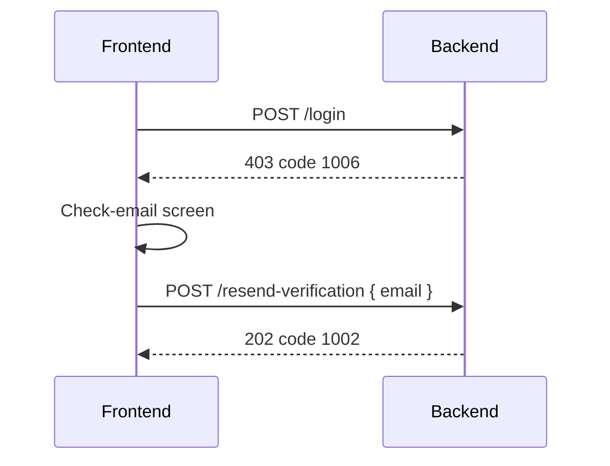
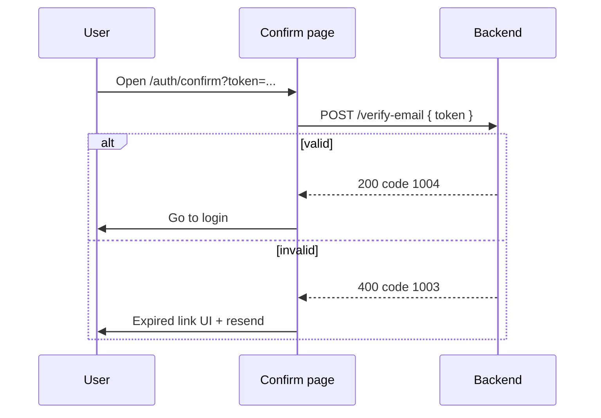
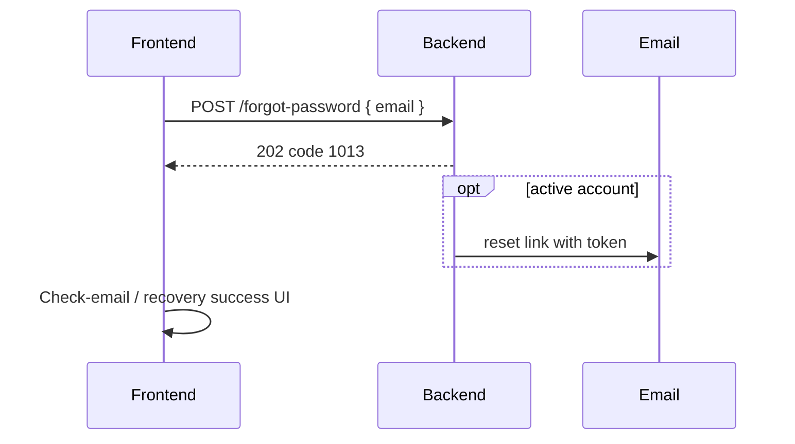
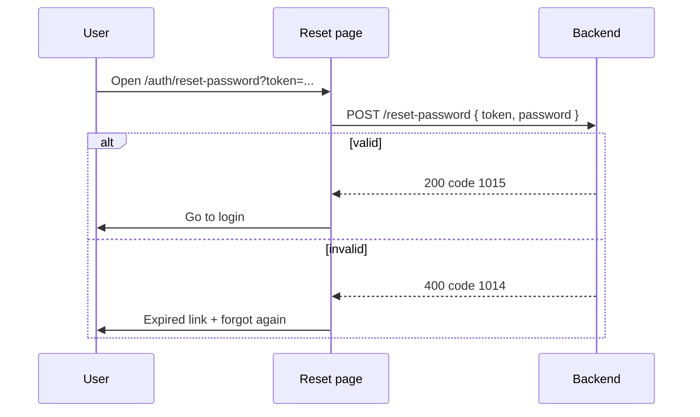
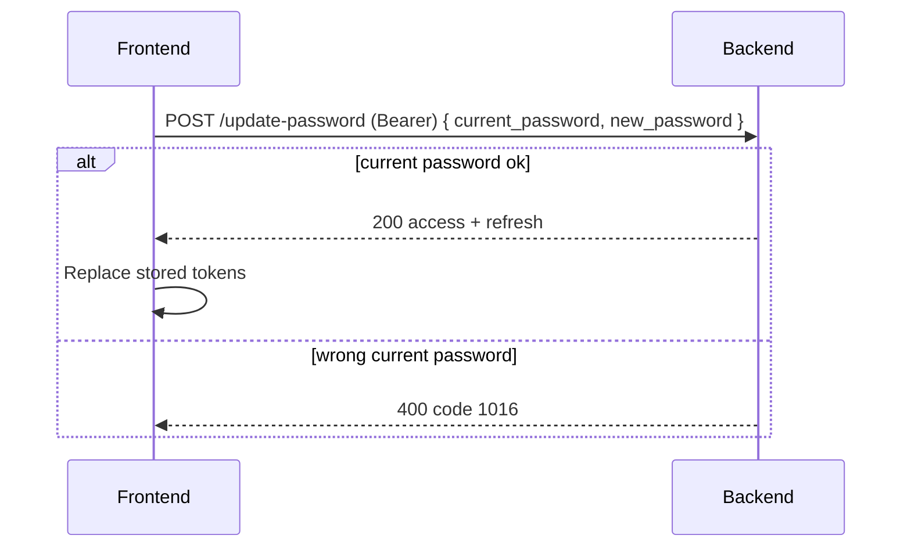
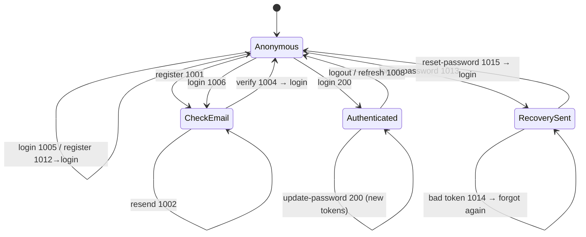

# Authentication API (frontend contract)

Base path: `/api/v1/auth`  
Local URLs: `http://api.dreamday.local` (Nginx) or `http://localhost:8000`.

Success bodies use `{ "code": number, "message": string }` at the top level.  
Error bodies put the same shape under `detail`:

```json
{ "detail": { "code": 1005, "message": "Invalid email or password." } }
```

Use **`code`** for i18n / branching. Treat `message` as an English fallback only.

Emails are normalized server-side (`strip` + lowercase). Password on register: **12–128** characters.

---

## End-to-end overview



---

## Token model (after successful login)

| Token | Where to store | How used |
| --- | --- | --- |
| `access_token` | Memory or short-lived storage | `Authorization: Bearer <access_token>` on protected calls |
| `refresh_token` | Secure persistent storage (e.g. httpOnly cookie or secure storage) | `POST /refresh` and `POST /logout` body |

Login / refresh response:

```json
{
  "access_token": "...",
  "token_type": "bearer",
  "expires_in": 900,
  "refresh_token": "...",
  "refresh_expires_in": 2592000
}
```

- When access expires or `/me` returns `401` with `1010`, call **`POST /refresh`** with the current refresh token.
- On refresh success, **replace** both tokens; discard the old refresh token.
- If refresh fails (`401` / `1008`), clear session and send the user to login.
- **Never reuse** an old refresh token after rotation: reuse revokes the whole token family.



---

## Message codes

| Code | HTTP (typical) | Meaning | Frontend action |
| --- | --- | --- | --- |
| `1001` | `202` | Registration accepted; verification email may be sent | Check-email screen |
| `1002` | `202` | Resend accepted (always, even if no mail sent) | Stay on check-email; optional toast |
| `1003` | `400` | Invalid or expired verification link | Error on confirm page; offer resend / register |
| `1004` | `200` | Email verified | Redirect to login |
| `1005` | `401` | Invalid email or password | Inline form error |
| `1006` | `403` | Email not verified | Check-email screen; call resend |
| `1007` | `403` | Account disabled | Dedicated disabled message |
| `1008` | `401` | Invalid or expired refresh token | Clear session → login |
| `1009` | `401` | Missing Bearer access token | Treat as logged out / refresh or login |
| `1010` | `401` | Invalid or expired access token | Try refresh, else login |
| `1011` | `200` | Logged out | Clear tokens → login |
| `1012` | `409` | Email already registered | Point user to login |
| `1013` | `202` | Forgot-password accepted (always) | “Check your email” UI |
| `1014` | `400` | Invalid or expired password reset link | Error on reset page; offer forgot again |
| `1015` | `200` | Password reset success | Redirect to login |
| `1016` | `400` | Current password incorrect (`/update-password`) | Inline error on update-password form |

Validation failures (wrong shape / short password) are FastAPI `422` — not these codes.  
New passwords (register / reset / update) must be **12–128** characters.

---

## Endpoints

### `POST /register`

**Body**

```json
{ "email": "user@example.com", "password": "at-least-12-chars" }
```

| Result | Status | Code | FE |
| --- | --- | --- | --- |
| New email | `202` | `1001` | Check-email screen (mail sent by API) |
| Email already exists | `409` | `1012` | “Already have an account?” → login |

Do **not** treat `202` as “logged in”. No tokens yet.



---

### `POST /resend-verification`

**Body**

```json
{ "email": "user@example.com" }
```

| Result | Status | Code | Notes |
| --- | --- | --- | --- |
| Always (unknown / verified / unverified) | `202` | `1002` | Anti-enumeration: response shape is the same |

FE should call this from the **check-email** screen (after register, or after login `1006`).  
During resend cooldown the API may reuse the same link; after cooldown it issues a new one. FE does not need to handle that distinction.



---

### `POST /verify-email`

Used by the confirmation page. Read `token` from the email link query string (`EMAIL_VERIFICATION_URL` + `?token=...`), then:

**Body**

```json
{ "token": "<from query string>" }
```

| Result | Status | Code | FE |
| --- | --- | --- | --- |
| Success | `200` | `1004` | “Verified” → login |
| Bad / expired / already used | `400` | `1003` | Error + link to resend or register |

Do not cache this response. Prefer POST (not GET) for the API call.



---

### `POST /login`

**Body**

```json
{ "email": "user@example.com", "password": "..." }
```

| Result | Status | Code | FE |
| --- | --- | --- | --- |
| Success | `200` | — (token payload) | Persist tokens; enter app |
| Bad credentials | `401` | `1005` | Form error |
| Not verified | `403` | `1006` | Check-email + `POST /resend-verification` |
| Disabled | `403` | `1007` | Disabled message |

Login does **not** send verification email. FE must call resend explicitly on `1006`.

---

### `POST /forgot-password`

Aligned with fastapi-users: always `202` (anti-enumeration).

**Body**

```json
{ "email": "user@example.com" }
```

| Result | Status | Code | Notes |
| --- | --- | --- | --- |
| Always | `202` | `1013` | Mail sent only if an **active** account exists |

FE: show “If an account exists, we sent a link” — same copy whether or not the email is registered.  
Reset page URL comes from `PASSWORD_RESET_URL` with `?token=...`.



---

### `POST /reset-password`

Public. Used by `/auth/reset-password?token=...` (or equivalent).

**Body**

```json
{ "token": "<from query string>", "password": "at-least-12-chars" }
```

| Result | Status | Code | FE |
| --- | --- | --- | --- |
| Success | `200` | `1015` | Clear any old session → login |
| Bad / expired token | `400` | `1014` | Error + link back to forgot-password |

On success the API also: marks email verified (proof of inbox access), revokes **all** refresh tokens for that user.



---

### `POST /update-password`

Authenticated (`Authorization: Bearer <access_token>`). Requires the **current** password (stricter than fastapi-users’ password-only patch).

**Body**

```json
{
  "current_password": "old-password",
  "new_password": "at-least-12-chars"
}
```

| Result | Status | Code / body | FE |
| --- | --- | --- | --- |
| Success | `200` | Same token payload as login (no `code` field) | **Replace** stored access + refresh |
| Wrong current password | `400` | `1016` | Inline form error |
| Missing / bad access | `401` | `1009` / `1010` | Refresh or login |

All previous refresh tokens are revoked; response is a fresh token pair so the user stays signed in on this device.



---

### `POST /refresh`

**Body**

```json
{ "refresh_token": "..." }
```

Success: same shape as login tokens. Failure: `401` / `1008` → clear session.

---

### `POST /logout`

**Body**

```json
{ "refresh_token": "..." }
```

Always treat as logged out on the client after calling (or if call fails, still clear local tokens). Success: `200` / `1011`.

---

### `GET /me`

**Headers:** `Authorization: Bearer <access_token>`

| Result | Status | Code | FE |
| --- | --- | --- | --- |
| OK | `200` | — | `{ id, email, is_email_verified, created_at }` |
| Missing Bearer | `401` | `1009` | Refresh or login |
| Bad / expired access, or inactive / unverified user | `401` | `1010` | Refresh or login |

---

## Recommended frontend screens

| Screen | Trigger |
| --- | --- |
| Register form | `/auth/register` |
| Login form | `/auth/login` |
| Check email | After `1001`, or login `1006`; include **Resend** → `/resend-verification` |
| Confirm email | `/auth/confirm?token=...` → `/verify-email` |
| Forgot password | Form → `POST /forgot-password` → recovery success / check-email copy (`1013`) |
| Reset password | `/auth/reset-password?token=...` → `POST /reset-password` |
| Update password (logged in) | `/auth/update-password` → `POST /update-password` with Bearer + current/new password |
| App shell | Has valid session; load `/me` as needed |



---

## Implementation checklist (FE)

1. Branch UI on `detail.code` (and success `code`), not on English `message`.
2. Register `409`/`1012` → login CTA; do not stay on a false “check email” for duplicates.
3. Login `1006` → check-email UI + call resend (backend will not auto-send on login).
4. Store and rotate refresh tokens correctly; never keep using a rotated refresh token.
5. Attach Bearer access token only; send refresh only to `/refresh` and `/logout`.
6. Confirm page: read `token` query param → `POST /verify-email`.
7. Forgot password: always treat `1013` as success UI; do not reveal whether the email exists.
8. Reset page: read `token` → `POST /reset-password`; on `1015` go to login.
9. Update password: send `current_password` + `new_password` with Bearer; on success **replace** tokens (response is token payload, not a `code`).
10. After logout, failed refresh, or successful **reset-password**, clear auth state before showing login.
