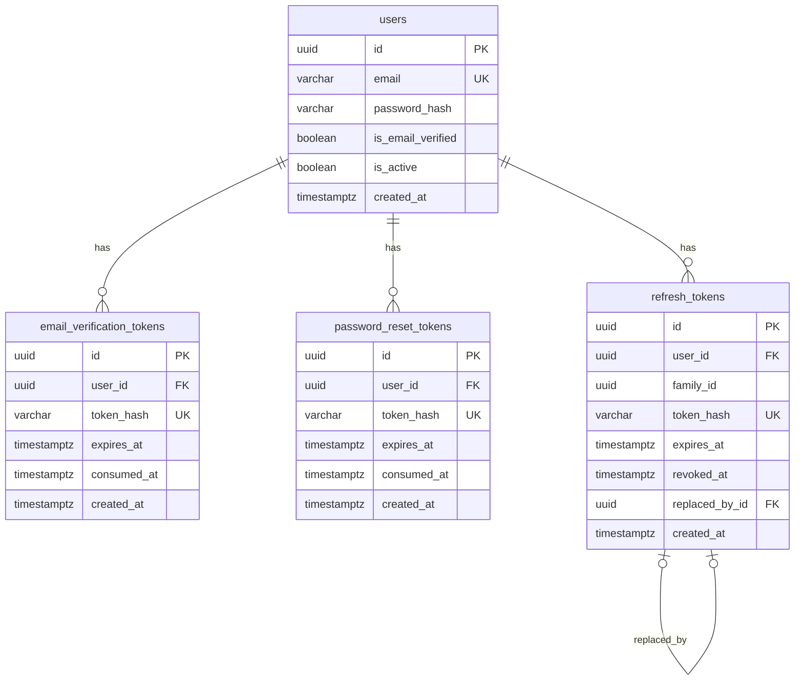

# Database ERD

Source of truth: `apps/backend` SQLAlchemy models and Alembic migrations.  
Current schema is auth-only (PostgreSQL).

## Overview

## Relationships

| From | To | Cardinality | On delete | Notes |
| --- | --- | --- | --- | --- |
| `email_verification_tokens.user_id` | `users.id` | N → 1 | `CASCADE` | One-time email verify links |
| `password_reset_tokens.user_id` | `users.id` | N → 1 | `CASCADE` | One-time password reset links |
| `refresh_tokens.user_id` | `users.id` | N → 1 | `CASCADE` | Opaque refresh sessions |
| `refresh_tokens.replaced_by_id` | `refresh_tokens.id` | 0..1 → 0..1 | `SET NULL` | Rotation chain within a login family |

## Tables

### `users`

| Column | Type | Constraints |
| --- | --- | --- |
| `id` | `uuid` | PK |
| `email` | `varchar(320)` | unique, not null |
| `password_hash` | `varchar(255)` | not null |
| `is_email_verified` | `boolean` | not null, default `false` |
| `is_active` | `boolean` | not null, default `true` |
| `created_at` | `timestamptz` | not null, default `now()` |

### `email_verification_tokens`

| Column | Type | Constraints |
| --- | --- | --- |
| `id` | `uuid` | PK |
| `user_id` | `uuid` | FK → `users.id`, not null |
| `token_hash` | `varchar(64)` | unique, not null (SHA-256 of raw token) |
| `expires_at` | `timestamptz` | not null |
| `consumed_at` | `timestamptz` | nullable; set when used or superseded |
| `created_at` | `timestamptz` | not null, default `now()` |

Index: `(user_id, created_at)`.

### `password_reset_tokens`

Same shape as `email_verification_tokens` (separate table for purpose isolation).

Index: `(user_id, created_at)`.

### `refresh_tokens`

| Column | Type | Constraints |
| --- | --- | --- |
| `id` | `uuid` | PK |
| `user_id` | `uuid` | FK → `users.id`, not null |
| `family_id` | `uuid` | not null; groups tokens from one login |
| `token_hash` | `varchar(64)` | unique, not null |
| `expires_at` | `timestamptz` | not null |
| `revoked_at` | `timestamptz` | nullable |
| `replaced_by_id` | `uuid` | FK → `refresh_tokens.id`, nullable |
| `created_at` | `timestamptz` | not null, default `now()` |

Index: `(family_id)`.

## Notes for readers

- All datetime columns are PostgreSQL **`timestamptz`**. Backend stores/compares UTC (`UtcDateTime` / `utc_now()`). FE↔BE JSON datetimes are UTC ISO-8601 with a `Z` suffix; convert to a local zone only for display.
- Raw verification / reset / refresh secrets are **never** stored; only hashes.
- Deleting a user cascades to all of their tokens.
- Refresh **rotation**: each successful `/refresh` inserts a new row, revokes the old one, and sets `replaced_by_id`. Reuse of a revoked token revokes the whole `family_id`.
